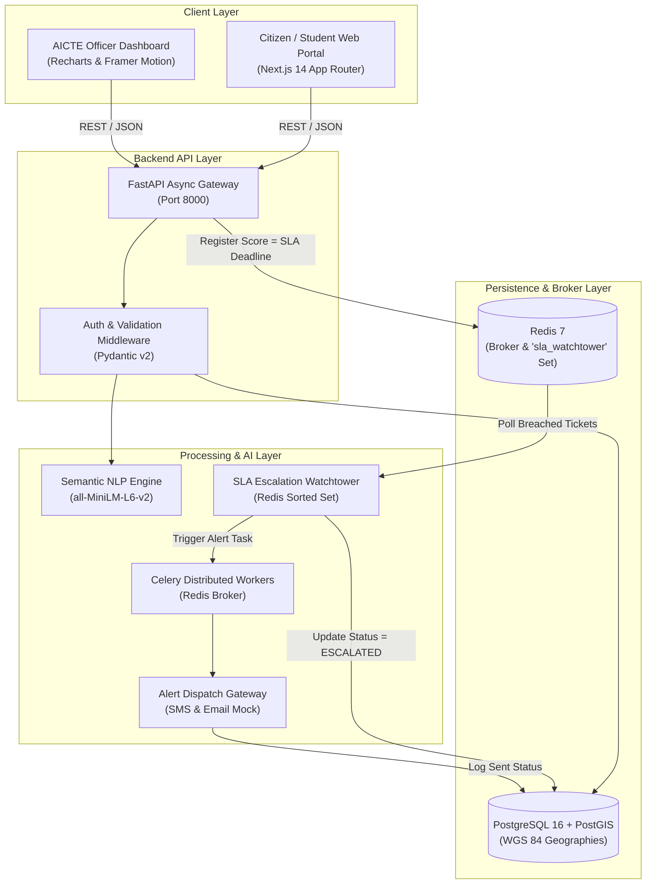

# 🏛️ System Architecture - Grievance360

This document defines the high-level architecture, data pipeline, and asynchronous task execution model of the Grievance360 platform.

---

## 📐 Architecture Diagram

---

## 🔄 Grievance Lifecycle & AI Pipeline

1. **Intake**: Citizen/student submits grievance via Next.js form with institution and category.
2. **Semantic Embedding**: FastAPI passes textual description to `sentence-transformers` (`all-MiniLM-L6-v2`) to generate vector representations.
3. **Duplicate Detection**: Cosine similarity check against recent complaints. If similarity > 0.85, flags ticket as a likely duplicate.
4. **Automated Triage & Routing**:
   - Compares cosine similarity with AICTE Bureau semantic profiles (*Anti-Ragging*, *Approval*, *Finance*, *Legal*, *Generic*).
   - Detects urgent keywords (`suicide`, `ragging`, `threat`, `violence`, `bribe`) to assign **`CRITICAL`** priority.
5. **Redis SLA Watchtower**:
   - Complaint ID is added to Redis sorted set `sla_watchtower` with score equal to epoch timestamp of `sla_deadline`.
   - Celery worker periodically executes `scan_and_escalate_breached_slas()`.
   - Tickets past deadline are escalated to `ESCALATED`, priority set to `CRITICAL`, system audit log inserted, and `send_dispatch_alert()` dispatches SMS/email.
6. **Resolution & Certificate**: Upon officer sign-off, resolution notice and audit trail are finalized.
